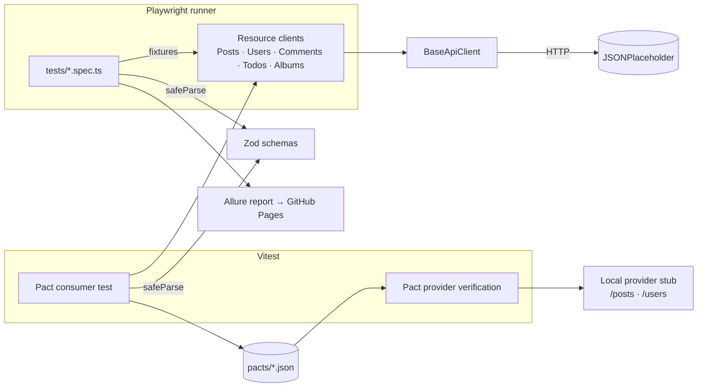

# playwright-api-framework

[](https://github.com/KKoygun/playwright-api-framework/actions/workflows/ci.yml)
[](https://kkoygun.github.io/playwright-api-framework/)

REST API test framework built with **Playwright**, **TypeScript**, **Zod schema validation**, **Pact contract testing** and **Allure reporting**.

Demonstrates the same architectural principles applied to API testing that Page Object Model brings to UI testing — typed client classes, fixture-based injection, schema contracts, and CI-ready parallel execution.

**Latest Allure report:** https://kkoygun.github.io/playwright-api-framework/ (published from `main` by the Pages workflow)

---

## Stack

| Tool | Purpose |
|---|---|
| [Playwright](https://playwright.dev/docs/api-testing) | HTTP request execution and assertions |
| TypeScript | Type safety across clients, schemas, and tests |
| [Zod](https://zod.dev) | Runtime schema validation — catches contract breaks immediately |
| [Pact](https://docs.pact.io) | Consumer-driven contract test, verified against a provider stub |
| [Vitest](https://vitest.dev) | Runs the Pact tests only; API suites stay on the Playwright runner |
| Allure | Test reporting, published to GitHub Pages |
| GitHub Actions | CI with parallel smoke/regression jobs and a contract job |

---

## Architecture



---

## Project Structure

```
src/
├── api/                    # API client classes (POM equivalent for HTTP layer)
│   ├── BaseApiClient.ts    # Shared GET/POST/PUT/PATCH/DELETE methods + request log
│   ├── PostsClient.ts      # /posts
│   ├── UsersClient.ts      # /users, /users/:id/posts
│   ├── CommentsClient.ts   # /comments, /posts/:id/comments
│   ├── TodosClient.ts      # /todos, filter by completed
│   └── AlbumsClient.ts     # /albums, /albums/:id/photos
├── schemas/                # Zod schemas — the response shapes the tests rely on
└── fixtures/
    └── apiFixtures.ts      # Playwright fixture extension — injects clients into tests

tests/                      # Playwright API suites (smoke + regression)
contract/
├── posts.consumer.pact.test.ts   # Consumer side: real clients against the Pact mock server
├── posts.provider.pact.test.ts   # Provider side: verifies the pact against the stub
└── providerStub.ts               # Minimal /posts and /users provider with Pact states
docs/decisions/             # Short decision records

.github/workflows/
├── ci.yml                  # Typecheck, contract tests, parallel smoke + regression, Allure merge
└── pages.yml               # Publishes the Allure report to GitHub Pages
```

---

## Key Design Decisions

**API Client Object pattern** — Each resource has its own typed client class extending `BaseApiClient`. Tests call `postsClient.getById(1)` rather than `request.get('/posts/1')`. This mirrors Page Object Model thinking: if an endpoint changes, one class changes, not every test. ([decision record](docs/decisions/0001-api-client-objects.md))

**Fixture injection** — Playwright's `test.extend()` injects pre-built client instances into every test function. Tests never construct clients manually, which keeps them readable and removes setup boilerplate.

**Zod schema validation first** — Schemas define the expected response shape. `PostSchema.safeParse(body)` catches missing fields, wrong types, or renamed properties at the point of response — not silently downstream. ([decision record](docs/decisions/0002-zod-schemas-first.md))

**Pact for the provider side** — one consumer-driven contract for `PostsClient`, verified on the provider side. ([decision record](docs/decisions/0003-pact-contract-test.md))

**Environment switching** — `ENV` picks the base URL from `baseURLMap` in `playwright.config.ts`. Only `dev` (JSONPlaceholder) is configured; add a `staging` entry and `ENV=staging npm test` runs the same suites against it with no test changes. Auth tokens flow in via environment variables.

---

## Zod or Pact?

They answer different questions, so this repo uses both.

| | Zod | Pact |
|---|---|---|
| Checks | The response *this client received* has the shape it expects | The *provider* still returns what the consumer expects |
| Runs | Inside every API test, against the real API | Consumer test writes a pact; the provider's pipeline verifies it |
| Catches a breaking change | After the provider deploys it, when our tests run | Before the provider releases it |
| Needs from the provider | Nothing | A verification step and provider states |

**Use Zod** everywhere, especially for APIs you do not own — it needs no cooperation. **Add Pact** where both sides are in your organisation and a provider change can break consumers in production; the contract then belongs in the provider's pipeline. JSONPlaceholder cannot verify a pact, so here the provider side runs against a local stub — with a real service, `providerBaseUrl` points at that service and the pact is shared through a Pact Broker.

---

## Quick Start

### Prerequisites
- Node.js 22+

### Setup

```bash
git clone https://github.com/KKoygun/playwright-api-framework

cd playwright-api-framework
npm install
cp .env.example .env
```

### Run tests

```bash
# All API tests
npm test

# Smoke only
npm run test:smoke

# Regression only
npm run test:regression

# Pact: consumer test, then provider verification (runs locally, no network)
npm run test:contract

npm run typecheck
```

### Generate Allure report

```bash
npm run allure:generate
npm run allure:open
```

---

## CI / CD

On every push to `main` or `develop`:

- **Type check**
- **Pact contract tests** — consumer, then provider verification; the pact file is uploaded as an artifact
- **Smoke and regression** in parallel, with Allure results merged into one report
- **Pages** — after a `main` run, `pages.yml` publishes that report to GitHub Pages (one-time setup: Settings → Pages → Source: GitHub Actions)

To add an API token for authenticated endpoints:

1. Add `API_TOKEN` to your GitHub repository secrets
2. Uncomment the `Authorization` header in `playwright.config.ts`

---

## Companion Repository

For UI automation, BDD (Cucumber), and AI agents (Healer, Planner, Generator): [Playwright-cucumber-ai-framework](https://github.com/KKoygun/Playwright-cucumber-ai-framework)

---

## Target API

Tests run against [JSONPlaceholder](https://jsonplaceholder.typicode.com) — a free, public REST API. To point the framework at your own API, update the `baseURLMap` in `playwright.config.ts`.
